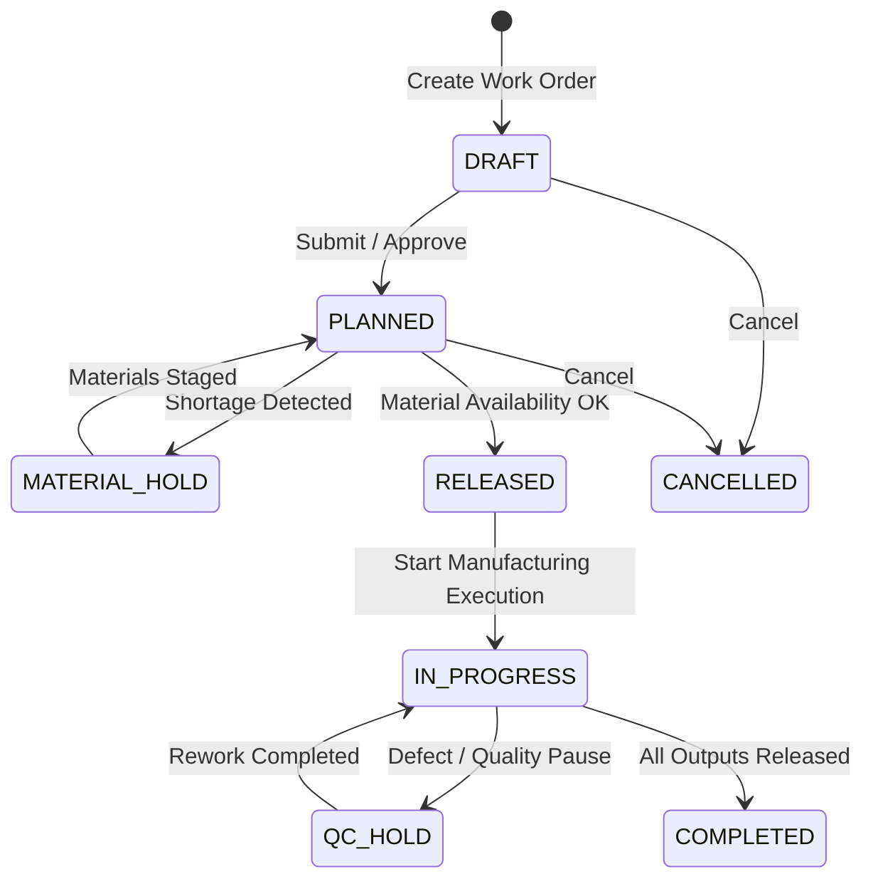

# Yash Group ERP — Production & Quality Module (M4) API Documentation

This document provides complete API reference, integration contracts, security controls, and end-to-end workflow documentation for Module M4: Production & Quality.

All endpoints are prefixed with:
`/api/production-quality`

---

## Table of Contents
1. [Authentication & RBAC Security](#1-authentication--rbac-security)
2. [Standard Response Envelope](#2-standard-response-envelope)
3. [M4.1 Planning & Work Orders Endpoints](#3-m41-planning--work-orders-endpoints)
4. [M4.2 Manufacturing Execution Endpoints](#4-m42-manufacturing-execution-endpoints)
5. [M4.3 Quality Control & Output Endpoints](#5-m43-quality-control--output-endpoints)
6. [Cross-Module Integration Contracts](#6-cross-module-integration-contracts)
7. [End-to-End Lifecycle State Machine](#7-end-to-end-lifecycle-state-machine)
8. [Database Integrity & Idempotency Rules](#8-database-integrity--idempotency-rules)

---

## 1. Authentication & RBAC Security

### Authentication Headers
Protected routes accept a valid, unexpired HS256 JWT in the `Authorization: Bearer <token>` header or a valid session ID in the `sessionId` cookie. JWTs require `iat` and `exp` claims and use the server's `JWT_SECRET`.

Every request to protected endpoints must include either a valid session token or testing header:
* `Authorization: Bearer <sessionId>`
* Or Cookie: `sessionId=<sessionId>`
* Test-only fallback (`NODE_ENV=test`):
  - `x-mock-role`: `ADMIN` | `PRODUCTION_MANAGER` | `QUALITY_INSPECTOR` | `ENGINEER`
  - `x-mock-user-id`: `<userId>`

Set `JWT_SECRET` in `backend/.env` to a unique, randomly generated value of at least 32 characters. The server does not provide a default secret.

### Current User
`GET /api/auth/me` returns the authenticated user's profile from the database. The response excludes password and other credential fields.

### Role-Based Access Control (RBAC) Matrix

| Endpoint Group | Allowed Roles | Description |
| :--- | :--- | :--- |
| **View Dashboards & Reports** | `ADMIN`, `PRODUCTION_MANAGER`, `QUALITY_INSPECTOR`, `ENGINEER` | Read-only inspection of metrics, calendars, and queues |
| **Create & Edit Work Orders** | `ADMIN`, `PRODUCTION_MANAGER`, `ENGINEER` | Create work orders in `DRAFT` status and edit parameters |
| **Approve & Release Work Orders**| `ADMIN`, `PRODUCTION_MANAGER` | Approve plans and release to shop floor with material check |
| **Start & Record Production** | `ADMIN`, `PRODUCTION_MANAGER`, `ENGINEER` | Start work orders, record shift outputs, scrap, and downtime |
| **Material Issues & Returns** | `ADMIN`, `PRODUCTION_MANAGER` | Transfer materials between store inventory and work orders |
| **Quality Decisions & Results** | `ADMIN`, `QUALITY_INSPECTOR`, `PRODUCTION_MANAGER` | Record dimensional/visual checks, issue `PASS`/`FAIL`/`HOLD` |
| **Finished Goods Release** | `ADMIN`, `QUALITY_INSPECTOR`, `PRODUCTION_MANAGER` | Idempotently release accepted items to FG store stock |

---

## 2. Standard Response Envelope

### Success Response (`200 OK` / `201 Created`)
```json
{
  "success": true,
  "message": "Resource created successfully",
  "data": {
    "id": 1,
    "workOrderNo": "WO-2026-0001",
    "status": "DRAFT"
  },
  "pagination": {
    "page": 1,
    "limit": 20,
    "totalItems": 1,
    "totalPages": 1,
    "hasNextPage": false,
    "hasPrevPage": false
  }
}
```

### Validation Error Response (`400 Bad Request`)
```json
{
  "success": false,
  "message": "Validation failed",
  "errors": [
    {
      "field": "plannedQuantity",
      "message": "Planned quantity must be greater than zero"
    }
  ],
  "error": {
    "message": "Validation failed"
  }
}
```

---

## 3. M4.1 Planning & Work Orders Endpoints

### 3.1 Get Production Dashboard
* **Endpoint**: `GET /api/production-quality/planning/dashboard`
* **Response**:
```json
{
  "success": true,
  "message": "Production dashboard metrics retrieved successfully",
  "data": {
    "metrics": {
      "totalWorkOrders": 12,
      "draft": 2,
      "planned": 3,
      "readyForProduction": 2,
      "inProgress": 3,
      "onHold": 1,
      "completed": 1,
      "cancelled": 0
    },
    "recentWorkOrders": [...]
  }
}
```

### 3.2 Create Work Order
* **Endpoint**: `POST /api/production-quality/work-orders`
* **Roles**: `ADMIN`, `PRODUCTION_MANAGER`, `ENGINEER`
* **Request Body**:
```json
{
  "salesOrderId": 1,
  "productId": 1,
  "plannedQuantity": 100,
  "bomRevisionId": 1,
  "priority": "HIGH",
  "plannedStart": "2026-11-01T08:00:00.000Z",
  "plannedEnd": "2026-11-05T18:00:00.000Z",
  "notes": "Earthing electrode batch for metro rail contract"
}
```
* **Response (`201 Created`)**:
```json
{
  "success": true,
  "message": "Work Order created successfully",
  "data": {
    "id": 1,
    "workOrderNo": "WO-2026-0001",
    "salesOrderId": 1,
    "status": "DRAFT",
    "plannedQuantity": "100.000",
    "goodQuantity": "0.000",
    "rejectedQuantity": "0.000",
    "priority": "HIGH",
    "items": [...]
  }
}
```

### 3.3 Check Material Availability
* **Endpoint**: `GET /api/production-quality/material-availability/:workOrderId`
* **Response**:
```json
{
  "success": true,
  "message": "Material availability report generated successfully",
  "data": {
    "workOrderId": 1,
    "workOrderNo": "WO-2026-0001",
    "isSufficient": true,
    "componentsCount": 2,
    "shortagesCount": 0,
    "materials": [
      {
        "productId": 2,
        "productName": "Copper Pipe 50mm x 3m",
        "sku": "RAW-COPPER-PIPE-50",
        "requiredQuantity": 100,
        "physicalQuantity": 500,
        "reservedQuantity": 100,
        "availableQuantity": 400,
        "shortfall": 0,
        "status": "AVAILABLE"
      }
    ]
  }
}
```

### 3.4 Work Order Lifecycle Transitions
* `POST /work-orders/:id/submit`: Submits `DRAFT` → `PLANNED`.
* `POST /work-orders/:id/approve`: Approves work order.
* `POST /work-orders/:id/release`: Releases to manufacturing if material availability passes; otherwise flags `MATERIAL_HOLD`.
* `POST /work-orders/:id/hold`: Body: `{ "reason": "...", "holdType": "MATERIAL_HOLD" }`.
* `POST /work-orders/:id/resume`: Resumes back from hold.
* `POST /work-orders/:id/cancel`: Body: `{ "reason": "..." }`.

---

## 4. M4.2 Manufacturing Execution Endpoints

### 4.1 Start Manufacturing Execution
* **Endpoint**: `POST /api/production-quality/manufacturing/work-orders/:id/start`
* **Request Body**:
```json
{
  "shift": "SHIFT_A",
  "workCenter": "WC-ASSEMBLY-01",
  "notes": "Starting daytime production run"
}
```

### 4.2 Record Production Entry
* **Endpoint**: `POST /api/production-quality/manufacturing/production-entries`
* **Request Body**:
```json
{
  "workOrderId": 1,
  "quantityProduced": 50,
  "shift": "SHIFT_A",
  "workCenter": "WC-ASSEMBLY-01",
  "notes": "First lot complete"
}
```

### 4.3 Issue Material from Store
* **Endpoint**: `POST /api/production-quality/manufacturing/material-issues`
* **Request Body**:
```json
{
  "workOrderId": 1,
  "productId": 2,
  "quantity": 50,
  "batchNumber": "COPPER-LOT-881",
  "locationCode": "RM Store Bay 2"
}
```

### 4.4 Record Scrap, Downtime & Transfer to Quality
* `POST /manufacturing/scrap`: `{ "workOrderId": 1, "quantity": 2, "reason": "Burr defect during cutting" }`
* `POST /manufacturing/downtime`: `{ "workOrderId": 1, "machineOrWorkCenter": "Saw #1", "durationMinutes": 20, "reason": "Blade recalibration" }`
* `POST /manufacturing/outputs/:id/transfer-to-quality`:
```json
{
  "quantity": 48,
  "batchNumber": "LOT-2026-NOV-01",
  "notes": "Transferring for dimensional and coating inspection"
}
```
* **Response**: Generates inspection serial `QI-YYYY-XXXX` with status `PENDING`.

---

## 5. M4.3 Quality Control & Output Endpoints

### 5.1 Inspection Queue
* **Endpoint**: `GET /api/production-quality/quality/inspection-queue`
* **Returns**: Batches awaiting testing.

### 5.2 Record Inspection Results & Measurements
* **Endpoint**: `POST /api/production-quality/quality/inspections/:id/results`
* **Request Body**:
```json
{
  "acceptedQuantity": 48,
  "rejectedQuantity": 0,
  "measurements": {
    "dimensional": [
      { "parameter": "Outer Diameter", "specified": "50mm", "measured": "50.1mm", "status": "PASS" }
    ],
    "visual": [
      { "check": "Surface Finish", "result": "Uniform coating", "status": "PASS" }
    ]
  },
  "evidenceNotes": "Passed all IS 3043 criteria."
}
```

### 5.3 Release Finished Goods to Inventory
* **Endpoint**: `POST /api/production-quality/quality/finished-goods-releases`
* **Request Body**:
```json
{
  "inspectionId": 1,
  "warehouseLocation": "Finished Goods Bay 1",
  "batchNumber": "LOT-2026-NOV-01",
  "notes": "Released to available inventory"
}
```
* **Guarantees**:
  - Increments finished product stock in `Inventory`.
  - Creates `InventoryMovement: STOCK_IN` with reference to the `WorkOrder`.
  - Sets inspection status to `RELEASED`.
  - If total released meets the planned work order quota, automatically sets `WorkOrder.status = COMPLETED`.
  - Strictly idempotent: repeated release requests return `409 Conflict`.

---

## 6. Cross-Module Integration Contracts

```text
[Sales Order Management] ---> Confirmed Sales Order ID & Quantity
                                       │
                                       ▼
                             [Planning & Work Orders]
                                       │
[Product & Engineering]  ---> BOMRevision (Items & Operations)
                                       │
                                       ▼
                             [Material Availability]
                                       │
[Inventory & Stores]     <---> Checks Available Stock / Issues Material
                                       │
                                       ▼
                             [Manufacturing Execution]
                                       │
                                       ▼
                             [Quality Control & Inspections]
                                       │
[Finished Goods Inventory]<--- Stock-In Movement on Release
```

---

## 7. End-to-End Lifecycle State Machine



---

## 8. Verification & Test Execution

Run the automated test suite using PowerShell:
```powershell
Set-Location .\backend
npm test
```
All unit, lifecycle, and security tests execute using Node.js native test runner.
